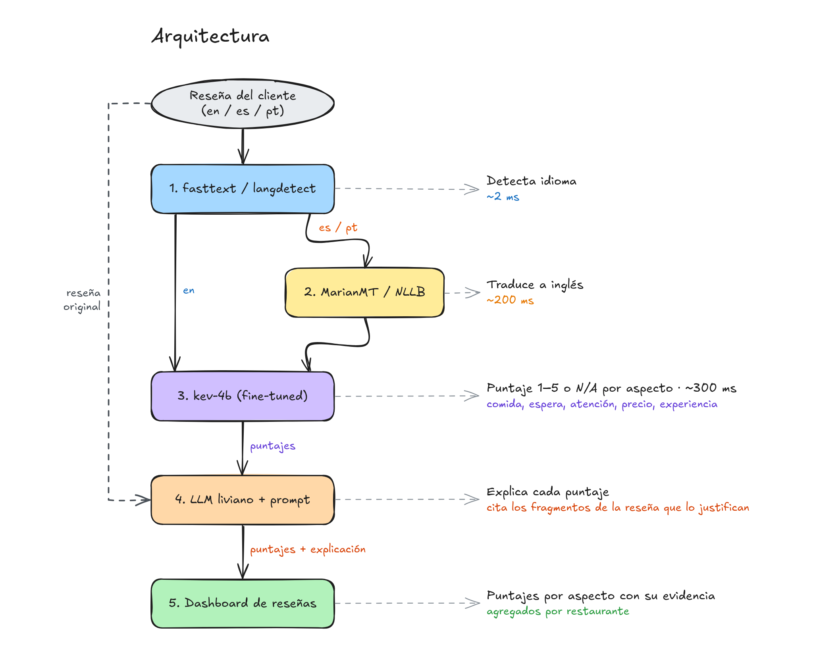

# Análisis de reseñas de restaurantes por aspecto

Las plataformas de reseñas resumen toda la experiencia en una sola calificación de 1 a 5 estrellas. Eso no dice qué generó la opinión: una misma reseña puede elogiar la comida y quejarse del precio. Este proyecto puntúa por separado cada aspecto que menciona la reseña, y un dashboard le muestra al restaurante qué mejorar.

## Dimensiones

Cada reseña recibe un puntaje de 1 a 5, o N/A si no menciona el aspecto, en:

| Dimensión | Clave en el código |
|---|---|
| Satisfacción con la comida | `food` |
| Tiempo de espera | `wait_time` |
| Atención | `service` |
| Precio | `price` |
| Experiencia | `experience` |

Ejemplo: *"Primera vez que hago fila en una panadería a las 10 de la noche, pero valió la pena. La tarta de durazno y los macarons estaban increíbles [...] Lo único flojo fue el croissant, que no estaba fresco. Aun así, volvería sin dudas."* (Yelp: 4 estrellas)

| Dimensión | Puntaje | Evidencia |
|---|---|---|
| Satisfacción con la comida | 4/5 | Tarta, macarons y Napoleón buenos; croissant no fresco. |
| Tiempo de espera | 3/5 | Hizo fila a las 22:00, aunque valió la pena. |
| Atención | N/A | No menciona al personal. |
| Precio | N/A | No menciona precios. |
| Experiencia | 5/5 | Volvería sin dudas. |

Los criterios de cada dimensión están en [`few_shot_etiquetado_resenas.md`](few_shot_etiquetado_resenas.md) y las preguntas que se le hacen al modelo en [`engine/instructions/`](engine/instructions/).

## Arquitectura



Una reseña llega desde el formulario (`dashboard/opinar.html`) a la API, que la guarda, responde enseguida y la analiza de fondo:

1. **fastText** (`lid.176`) detecta el idioma: en, es o pt (< 1 ms).
2. **Hy-MT2-1.8B** (Tencent, por OpenRouter) traduce al inglés las reseñas en español o portugués. Las de inglés se saltan este paso.
3. **kev-4b fine-tuneado** (en un pod de RunPod) lee la traducción y devuelve un puntaje de 1 a 5, o N/A, para cada dimensión.
4. **Qwen3.5-9B** (por OpenRouter) recibe la reseña **original** y los puntajes, y para cada aspecto devuelve una cita textual de la reseña y una explicación corta en español. El puntaje siempre sale de kev, nunca de Qwen.
5. **El dashboard** muestra reseña por reseña el puntaje, la cita y la explicación de cada aspecto, el promedio por dimensión y lo principal a arreglar.

El pod de kev se crea solo cuando llega una reseña y se borra después de unos minutos sin uso, así la GPU no cobra de más.

## Modelo

Usamos [jaredpalmer/kev-4b](https://huggingface.co/jaredpalmer/kev-4b), un modelo de decisión (Qwen3.5-4B-Base + LoRA). No es un LLM generativo: recibe un texto y un conjunto de preguntas tipadas, y devuelve una distribución de probabilidad por pregunta en una sola pasada, sin generar texto. Cada dimensión es una pregunta de opción múltiple (`1`–`5` o `N/A`) sobre la reseña.

kev se entrenó solo en inglés, por eso las reseñas en español y portugués se traducen antes. Los datos de fine-tuning se tradujeron con el mismo traductor (Hy-MT2), así kev ve en producción traducciones del mismo estilo que las que vio al entrenar.

### Fine-tuning

Fine-tuneamos kev con nuestras reseñas etiquetadas: LoRA de rango 16 sobre kev-4b, 2 épocas, unos 60 minutos en una GPU. Las reseñas de más de 384 tokens quedan afuera (unas 28 en train).

Resultados en **test**, contra kev-4b sin tocar (mismas reseñas):

| Métrica | kev-4b base | Fine-tuneado |
|---|---|---|
| NLL (calidad de las probabilidades, menor es mejor) | 0.53 | **0.39** |
| Accuracy cuando hay puntaje (etiqueta 1–5) | 0.75 | **0.79** |
| Respuestas aceptables solas con ~95% de accuracy | 67% | **76%** |
| Accuracy en `wait_time` | 0.45 | **0.62** |

El modelo está publicado en [enzost98/kev-reviews](https://huggingface.co/enzost98/kev-reviews), solo para **uso académico no comercial** (se entrenó con reseñas de Yelp): para bajarlo hay que aceptar esos términos.

El error más común sigue siendo confundir 4 con 5. El análisis completo está en [`notebooks/06_kev_eval/finetune_results.ipynb`](notebooks/06_kev_eval/finetune_results.ipynb) y los datos crudos en `kev_results/`.

## Datos

- **Fuente:** Yelp Restaurant Reviews, unas 20 000 reseñas (texto, fecha, rating 1–5). La URL se descarta para proteger a los autores.
- **Idiomas:** 1/3 se mantiene en inglés, 1/3 se traduce al español y 1/3 al portugués con [google/translategemma-4b-it](https://huggingface.co/google/translategemma-4b-it) (`notebooks/01_dataset/`).
- **Etiquetas:** el dataset solo trae el rating global, así que etiquetamos a mano 2 100 reseñas en las cinco dimensiones con una herramienta propia ([`tools/labeling/`](tools/labeling/README.md)). Un LLM sugiere las etiquetas con el prompt few-shot y una persona las revisa y corrige. Quedan en `reseñas/labels.db`.
- **Splits:** 1 470 train / 315 val / 315 test, con la misma cantidad de reseñas por idioma (`reseñas/splits/`). Para kev se traducen al inglés (`reseñas/splits_en/`) y se pasan al formato de entrenamiento (`reseñas/splits_en/kev/*.jsonl`, con `python -m tools.data`).

## Cómo correrlo

Necesita un `.env` en la raíz con `RUNPOD_API_KEY`, `KEV_API_KEY`, `OPENROUTER_API_KEY` y `HF_TOKEN`.

```bash
uv sync

# API + dashboard en Docker: dashboard en http://localhost:8080, API en http://localhost:8000
docker compose -f compose.app.yaml up -d --build

# O la API sola en local (http://127.0.0.1:8000/docs)
uv run uvicorn api.main:app --reload
```

Sin API, el dashboard funciona en modo demostración con las reseñas etiquetadas: abrir `dashboard/index.html` con Live Server (ver [`dashboard/README.md`](dashboard/README.md)).

Los detalles de cada pieza (estructura del repo, configuración, el pod de kev, bases de datos) están en [`CLAUDE.md`](CLAUDE.md).

## RestoAnalytics

RestoAnalytics analiza reseñas de restaurantes en español, inglés y portugués. En lugar de dar una sola calificación, puntúa cinco aspectos: comida, atención, tiempo de espera, precio y experiencia general. Si la reseña no aporta información suficiente sobre un aspecto, lo marca como N/A.

El tablero muestra los puntajes y sus explicaciones, acompañadas de citas de la reseña original cuando están disponibles.
